# 第三大脑 · Third Brain

把分散的办公对话、文档和会议资料，变成有依据的工作进展与可审阅的数据分析。

本仓库提供可独立安装的本地工作台。默认启动工作概览、业务问答、信息源管理、主动发现和项目记忆五个页面，采用与个人版一致的界面与通用运行引擎。每位安装者配置自己的授权、数据源和模型；仓库不包含维护者的业务记录。见[安装与能力范围](docs/WORKBENCH.md)。

## 为什么做第三大脑

我想让 AI 分身先承担反复查找、核对和整理已有信息的工作，把注意力留给需要本人判断和推进的事。选取 9 月一个自然周，从个人文档和办公聊天中识别出 **29 件新事项，其中 12 件（41.4%，约四成）**主要依赖已有事实、规则或数据。这些是第三大脑优先尝试承接的环节：查资料、对口径、整理进展并准备有依据的草稿；新的业务取舍与责任承诺留给人。

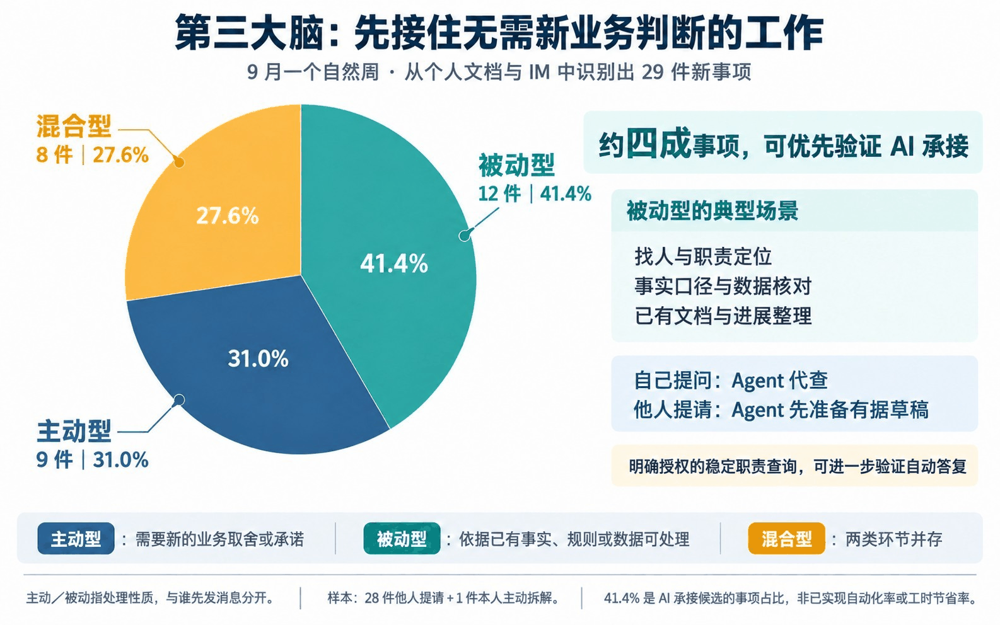

样本包含 28 件他人提请和 1 件本人主动拆解。图中“主动／被动”指处理性质，与谁先发消息无关；**41.4% 是候选事项占比，不代表已实现自动化率或工时节省。** [查看分类口径](docs/product/work-composition.md)。

**事情推进到哪里了？这个指标为什么变了？** 答案经常跨越几次对话、一份交接文档、当天的看板图片和后来的回复。第三大脑先把 AI 分身落到两个主要角色，并保留找人这个辅助入口：

| 角色 | 交付 | 当前边界 |
| --- | --- | --- |
| 工作进展助理 PMO | 当前进展、跟进对象、卡点及待确认事项，逐项有依据 | 催办、对外发送和冲突裁决由用户确认 |
| 数据诊断助理 DA | 明确查询、核对变化、按需下钻、形成待审报告 | 简单问题走短流程；归因需要事实，不能仅凭相关性断言 |
| 辅助：找人和组织协作 | 谁负责、应找谁 | 依赖准确组织资料，暂不承诺完整覆盖 |

## 设计理念

- 相关性比活跃度重要：候选来源不是已关注来源，手动设置和禁止优先。
- 工作主线是持续演进的工作对象：可以跨群、跨文档，不固定塞进一组初始主线；新增、合并和归档要有依据。
- 累计历史与当前展示分开：看板只展示重点，历史按来源、版本、时间和稳定标识去重保留。
- 先理解问题，再决定做多少：一个数字不必写成长报告，复杂问题才进入有限循环。
- Memory复用口径和经验，不能替代事实：规范、指标定义和日期事实分开，保留时效与来源。
- 人负责承诺和裁决：保留冲突与未知，不按职位或模型置信度自动覆盖事实。

## 整体架构

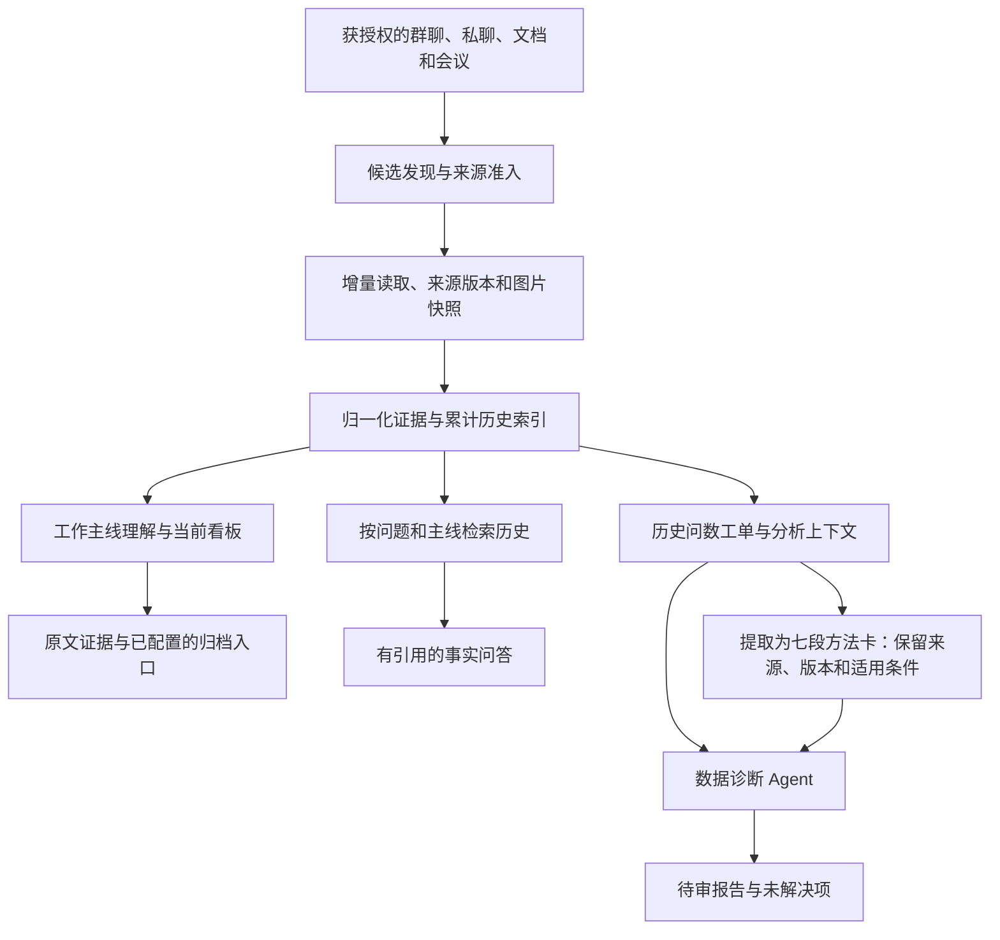

累计索引和项目Memory使用私有本地文件。Embedding向量检索尚未接入；Mem0、OpenViking等只提供过设计参考，不表示已部署其服务。归档入口也不表示归档内容已自动同步到今天。

## Agent 的工作闭环

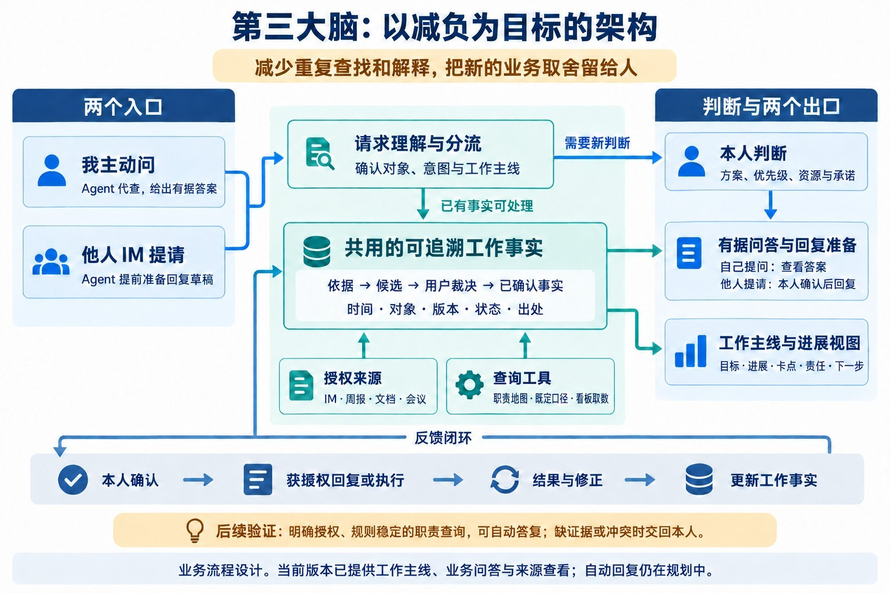

以请求分流、事实查证、回答准备和确认反馈四个阶段组织工作。图中展示整体业务设计；自动接收与回复、完整的事实确认闭环仍需继续验证。

数据诊断时，Agent在查证阶段完成标准Query改写、德普只读取数和结果核验；能回答原问题就形成待审报告，仍有可验证的假设则继续下钻，缺少口径或业务事实时请用户补充。最多三轮、三次查数，并受预算和权限限制。原话、引用原图、实际查询与结果分别保留。

## 当前模型与程序怎样分工

公开版按安装者实际配置运行，不把个人实验中的模型切换当作默认接入能力。

| 环节 | 当前公开实现 | 保留的边界 |
| --- | --- | --- |
| Query 分流与改写 | 诊断模型在同一轮规划中判断完整性、简单／复杂路线，并改写标准自然语言 Query | 程序检查引用对象、日期和已授权查询方案；缺必要条件就补充 |
| 文档准入与更新 | 程序检查来源准入、授权、版本和正文哈希 | 没有默认启用独立 Decision 语义判空；读取失败不当作没有内容 |
| Memory 召回 | 本地程序按方向、关键词和文本重合等线索筛选有限方法 | 来源、版本、时效、冲突和长度限制先行；当前没有独立 Decision 二次重排或向量检索 |
| 查数与复核 | 只读工具返回实际结果，诊断模型检查能否回答原问题 | 报告仍有缺口时继续查证或找人补充，不能用高置信度替代证据 |

个人试验做过 Decision 等模型的影子对照；这些试验不代表每位安装者已经接入同样的模型。当前工单记忆提取使用 DeepSeek，记忆管理由第三大脑本地模块完成，具体见下文。

## 从工单积累可复用的方法

Memory 是给下一次分析准备的经验卡。模型从历史提问和答复中提炼“怎么回答”，第三大脑按方向保存、查找，并在相关问题中把方法带入 Query 改写与结果复核。历史金额、旧结论和当前数据分开，复用方法时仍要重新查本期数据。

以完全虚构的案例说明：7 月核对某服务账单时，答复留下了对齐周期、拆分用量与单价、单列调整项的分析顺序。8 月再遇到同方向问题，就可以参考这个顺序，不必从一张白纸开始。

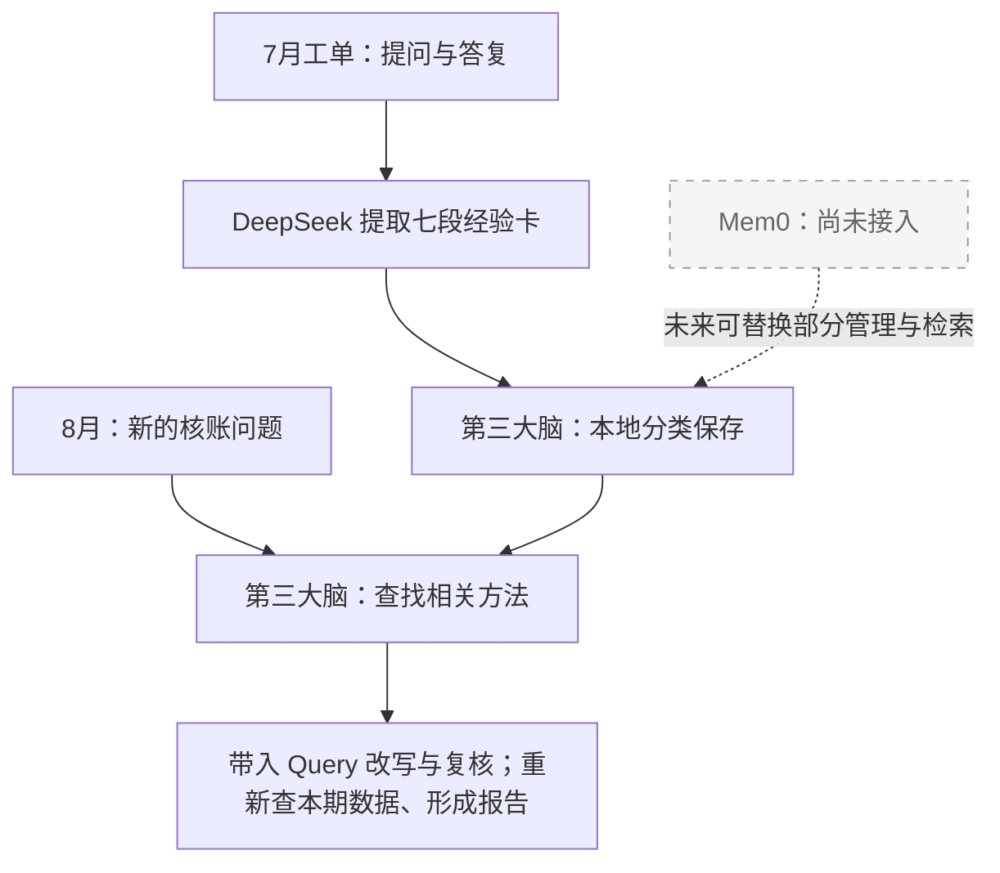

<details>
<summary>展开一张七段 Memory：某服务每月账单核对（全部为虚构示例）</summary>

**【原文】**

提问者：“7 月服务账单和内部用量汇总对不上，差在哪里？”

分析者：“先对齐结算周期和单位，再按资源类别核对用量、单价和费用。调整项单列，每项差异对应到凭据，未核实的先保留。”

**【问题模式】** 同一服务的周期性账单核对：解释账单与内部用量汇总的差异。

**【下次如何回答】**

1. 对齐本期结算周期、服务范围和计费单位。
2. 按相同资源类别核对用量、单价和费用。
3. 单列折扣、冲正及跨月调整，区分已解释和待核实的差异。

**【交付清单】** 可回查凭据的对照表，以及差异与缺失材料清单。

**【适用条件】** 同一服务的周期核账，账单与用量能够对应。

**【不能直接套用】** 不沿用 7 月金额、单价或差异原因；规则变化后先重核口径。

**【仍需当前资料】** 8 月账单与用量明细、本期计费规则、调整记录。

</details>

这是上下文工程：给分析助手补上相关经验，而不是把上个月的答案当成这个月的结论。提取校验成功后自动生效；工单中可以查看本单产出、命中的方法和实际带入内容。当前提取由工单按钮触发，不是每次会话结束都会自动执行。

**Mem0 在哪一环？当前没有接入。** 可以把模型想成“写经验卡的整理员”，把第三大脑本地模块想成“分类夹和目录”。现在两者已经负责抽取、保存、查找和注入；公开实现使用方向与关键词等线索召回，没有独立 Decision 重排或向量检索。将来若采用 Mem0，是替换部分记忆管理与检索模块的选项。

已有周期方法对照入口可以展示有／无记忆的实际模型回答，但该入口指定带入上期记忆、未执行真实查数，只能比较方法，尚不能证明完整 Loop 的收益。见 [完整案例、实现分工与配置](docs/product/memory.md)。

## 产品界面

下图是公开包干净安装后的实际页面：五页导航、Agent Loop 和节点规范可直接查看，未配置数据源时明确显示未就绪。

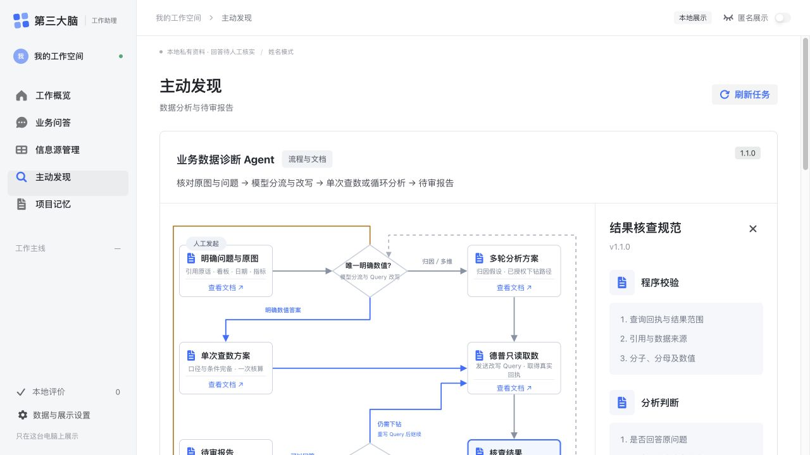


以下画面使用真实界面组件和完全虚构的 mock 数据截图；项目记忆与历史工单更新于 2026 年 10 月 24 日，其余画面保留 10 月 21 日版本。项目、成员、看板曲线、查询结果、报告和记忆均为示意，没有连接办公数据、模型或查数服务。首次安装没有业务数据，显示空状态。主动发现、历史工单和 Memory 需要安装者配置自己的来源与存储，见[工作台配置](docs/WORKBENCH.md)。

### 工作概览

紧急、待决策、待本人行动等标签使用不同颜色，区分当前工作与后续关注事项。


### 业务问答与依据回查

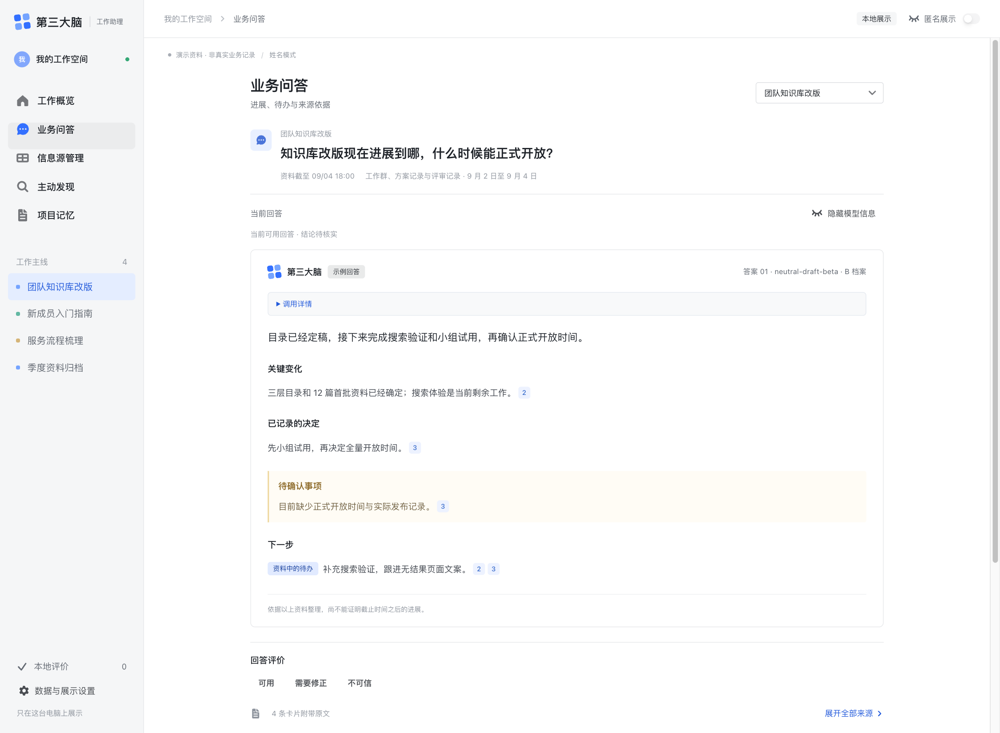

证据按段落、列表、加粗和链接呈现。历史问答用节点、角色标签和提问高亮区分原始提问、历史答复与后续追问，时间和来源作为辅助信息。发言人、@提及对象与引用回复使用一致的人物标识，点击回复对象可回到被引用的原话；公开示意统一使用虚构成员。截断资料明确标注不完整；匿名展示保守隐藏无法完整解析的正文。

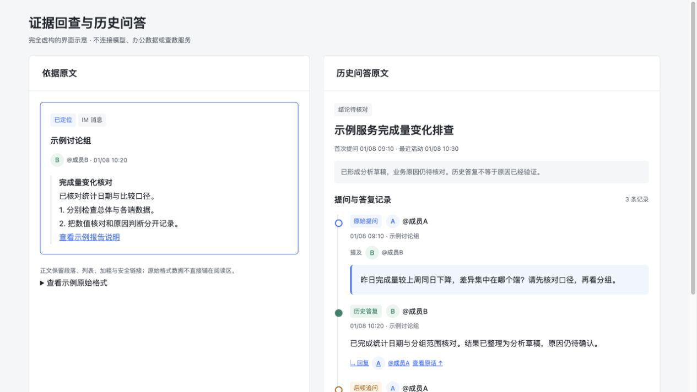

### 历史工单与引用回复

同一个问题保留提问、引用看板、答复和后续追问。虚构成员的发言人与 @对象保持一致，明确引用的回复可以定位到对应原话。

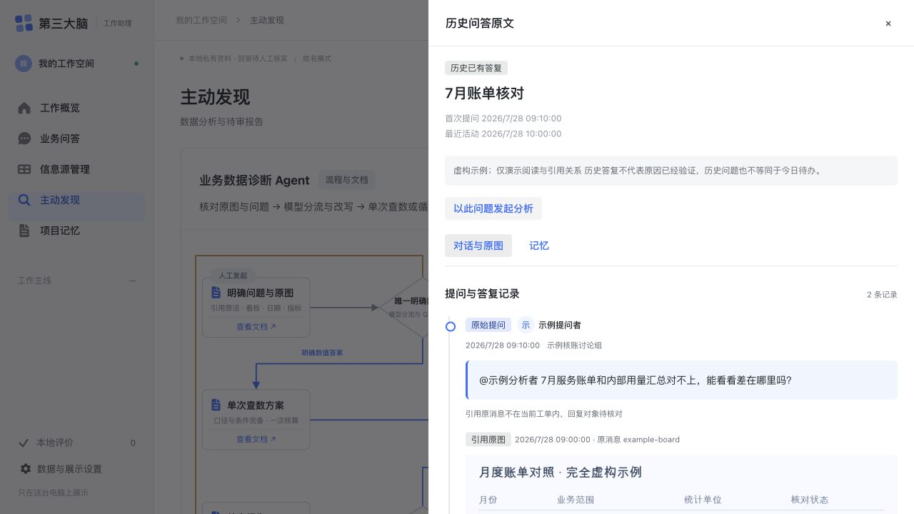

[查看可运行的通用展示示意](demo/evidence-timeline.html)（运行 `npm run demo` 后打开 `/evidence-timeline.html`）。此页只验证展示交互，不连接私人记录或分析服务，实际历史工单的引用、原图、时间线与 Memory 引擎位于 `apps/business-workbench`。

### 主动发现

核对原图和问题，再分流到单次查数或循环分析；每一步都可查看对应规范。

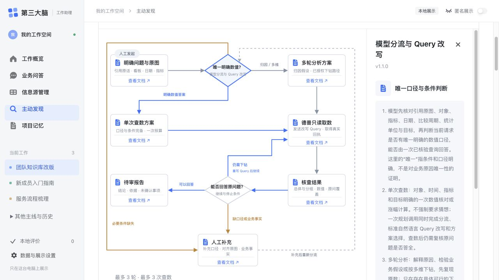

选择看板后查看统计日、推送时间和原图，再补充要分析的问题。

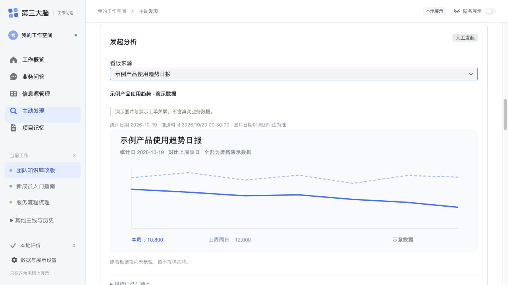

阶段报告区分已回答和仍缺少的部分，保留下一步需要人工补充的事实。


### 项目记忆

按成本核算、指标汇报、异常口径等方向阅读工单经验。每条固定为「原文、问题模式、下次如何回答、交付清单、适用条件、不能直接套用、仍需当前资料」七段；原文折叠，方法优先展示。来源校验通过的成功提取自动生效，不要求逐条确认。工单的「记忆」页可查看产出、匹配与实际带入记录。

提取使用安装者自己的 DeepSeek 配置，读取已绑定的提问、答复与可用原图；历史金额不替代本期数据。Mem0 尚未接入实际业务使用，当前由本地模块整理和检索。下图完全为虚构数据，未调用模型，没有伪造实际注入记录。见 [Memory 实现与配置](docs/product/memory.md)。

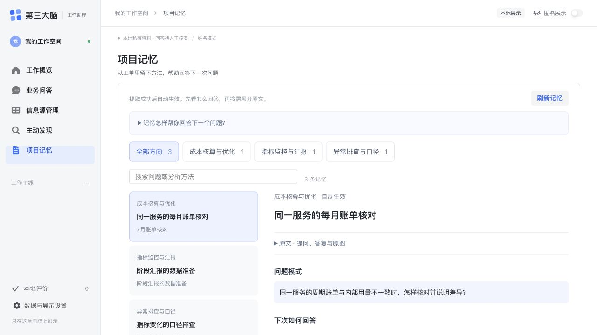

工单里的「记忆」页把本单产出、相关方法与分析时实际带入的内容分开查看。下面仍为虚构案例，没有伪造模型回答或注入记录。

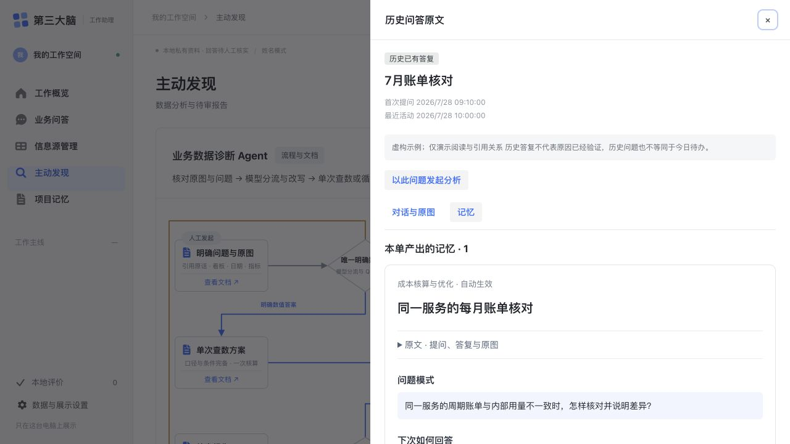

[截图范围与数据说明](docs/product/screenshots.md)。

## 如何评估

看任务结果，而不只看文风：核对问题和引用对象是否对齐、口径和日期是否正确、总体与分群是否答全、是否精确找人，以及人工补充、查询、调用、耗时和费用。Memory评测使用相同原问题、证据和截止时间的有/无Memory对照。

已做30条冻结样本、六类判断的双模型影子对照，共60次真实调用；包含控制变体且待人工评阅，一致率不是正确率。双方都曾高分漏判缺总体和统计单位的报告，单设高置信阈值不足以支持自动结束。该对照不是30次完整查数任务。

进一步阅读：[产品思路与需求拆解](docs/product/product-rationale.md)。

---

## 公开版 Alpha

这是可独立安装的 **Local-first Alpha 产品版**：每位安装者在自己的电脑运行服务，使用自己的 WPS 企业应用、用户 OAuth 和自选模型 API。维护者不会收到安装者的 Token、消息或分析结果。

项目同时维护“个人版”与“公开版”：新能力先在维护者的个人版验证，只有可公开的通用代码和产品承诺才会进入候选分支。发布流程是：**个人版验证 → 公开候选分支 → 隐私扫描与人工复核 → 用户确认 → 公开版**。维护者的私人文档、办公授权和本地数据不会同步进来。

默认入口已统一为新版五页工作台，旧 Alpha 仅在显式执行 `npm run start:legacy` 时启动。已有安装请更新代码、重新 `npm install`，然后重启 `npm start`；该命令自动构建新版前端。

## 能做什么

- 在本机完成 WPS 用户 OAuth；
- 使用当前用户身份读取其有权访问的会话，不要求把机器人加入群聊；
- 选择 1–10 个群聊，导入最近 1–30 天的文本消息；
- 只有在用户显式点击“分析”后，才把所选消息发送给该用户配置的 OpenAI-compatible 模型 API；
- 将 WPS Token、消息和分析结果加密保存在当前电脑；
- 展示业务化候选，供用户判断“重要、相关但非重点、噪声、不确定”。
- 新版问答与富文本证据回查，来源关注档位和最多10条主线的展示；
- 可配置的看板日期快照、引用原图、历史工单与回复时间线；
- 标准 Query、简单/复杂分流、只读查数、复核与有限循环、待审报告；
- 版本化分析规范、七段 Memory、方向筛选及实际注入记录。

后面三项使用真实通用引擎，必须配置安装者自己的本地文件、已授权查数方案和可用 MCP/模型；安装和浏览不会自动执行收费分析或生成虚构结果。详见[工作台能力与配置](docs/WORKBENCH.md)。

当前版本不会发送 WPS 消息、不会自动扩展监控来源、不会上传到维护者服务器，也不是生产部署。

当前仓库使用 [GNU Affero General Public License v3.0](LICENSE)。开源许可只适用于本仓库代码，不授权或要求公开任何安装者的 WPS 数据、模型 Key 或本地记忆。

## 问题反馈边界

公开 Alpha 暂未提供 **Report to Issue**，包括本地草稿、预览、确认、历史、更正和撤销。该能力会在后续独立 Ticket 中重新定义和验收；当前版本不保留任何可达入口。

## 五分钟开始

需要：Node.js 22.12+、一个 WPS 企业自建应用，以及一套 OpenAI-compatible 模型 API 配置。

```bash
npm install
npm start
```

首次启动会在终端显示本地地址。用浏览器打开 `http://127.0.0.1:4310` 后进入设置导览；页面会逐步告诉你：

1. 去哪里创建 WPS 企业自建应用并取得 App ID / App Key；
2. 需要申请哪两项 WPS 权限；
3. 在哪里填写本地 OAuth 回调地址；
4. 如何填写模型服务商、API 地址、模型名称／Endpoint ID 和自己的 API Key；
5. 哪些值只保存在当前电脑，不能发给别人。

按导览保存后，停止并重新运行：

```bash
npm start
```

也可以继续使用 `npm run setup` 手动创建 `.env.local`，再运行 `npm run preflight` 检查。

打开 `http://127.0.0.1:4310`，完成配置后按页面顺序：

1. 授权当前 WPS 账号；
2. 读取会话清单；
3. 选择 1–3 个熟悉的群和最近 7 天；
4. 导入消息；
5. 明确点击分析，再判断结果是否有用。

## WPS 应用配置

在 WPS 开放平台创建企业自建应用：

- 用户授权回调：`http://127.0.0.1:4310/oauth/wps/callback`
- 用户基础信息：搜索 `kso.user_base.read`，选择权限类型 `user`
- 用户消息 MCP：搜索 `kso.mcp_message.readwrite`，选择权限类型 `user`

不要在开放平台搜索框输入 `delegated:`，也不要选择同名的 `app` 权限。权限必须先在开发者后台申请并随版本审批发布，然后每位安装者使用自己的账号重新 OAuth。不要复制浏览器 `WPS_SID`。

详见 [WPS 权限与授权](docs/WPS-PERMISSIONS.md)。

## 隐私边界

- `.env.local`、`.runtime/`、日志和本地数据均被 Git 忽略；
- OAuth 凭证、导入消息及其分析结果在导入工作区使用 AES-256-GCM 加密；扩展工单、Memory、原图和刷新回执另存本地文件，当前不经过该加密存储，详见隐私说明；
- 本地加密主要防止误上传和明文泄漏，不能抵御已经控制该电脑账户的恶意程序；
- 安装、打开页面和浏览缓存不会调用模型；显式分析、提取／更新 Memory 等操作会把所需资料发送至相应配置的模型 API；
- 每人必须使用自己的 WPS OAuth 和模型 Key。严禁共用维护者或其他同事的办公凭证。

详见 [隐私说明](docs/PRIVACY.md)。

## 发布检查

```bash
npm test
npm run check
npm run verify
```

检查覆盖：凭证字面量、私人绝对路径、私人飞书/WPS 文档链接、数据文件、环境文件、软链接和独立安装。维护者还可传入只存在私人环境的 denylist：

```bash
node scripts/check-release.mjs --denylist /absolute/private/denylist.txt
node scripts/check-public-git.mjs --denylist /absolute/private/denylist.txt
npm run release:gate -- --denylist /absolute/private/denylist.txt
```

第一条检查当前文件，第二条检查已删除文件仍可能残留的完整 Git 历史。真正发布前必须运行第三条发布总门；它强制使用同一份私人 denylist，并串行执行当前文件、完整 Git 历史和干净安装验证。缺少 denylist 时发布总门会直接失败。

## 已验证与未验证

已在无私人配置的干净目录验证：安装、单元测试、发布扫描、配置预检和静态 Demo。

由于发布环境没有安装者的 WPS 应用、OAuth 和模型 Key，以下必须由每位试用者首次运行时验证：WPS 权限审批、真实 OAuth、会话读取、消息分页、所选模型请求与结果质量。未验证能力不会写成已完成。

进一步阅读：[安装](docs/INSTALL.md) · [架构](docs/ARCHITECTURE.md) · [模型配置](docs/MODEL-CONFIG.md) · [首版限制](docs/PREVIEW-LIMITS.md) · [隐私说明](docs/PRIVACY.md)

### 会邀与文档更新

新增独立的资料刷新入口：会邀补充工作安排，参会人的私聊先进入监控候选；会后检查记录，已准入文档按版本及正文哈希更新，日报、周报的图片另存本地并记录识别覆盖。网页“信息源管理”可加载本地回执并查看原图。未核实关联和未读图片会保留待处理状态。

见 [接入说明与验收边界](docs/product/calendar-document-context.md)。该入口需单独配置日历及云文档连接，默认不执行付费图片理解；原有 Alpha 群聊分析范围保持明确，不自动发布会议结论或 Memory。
