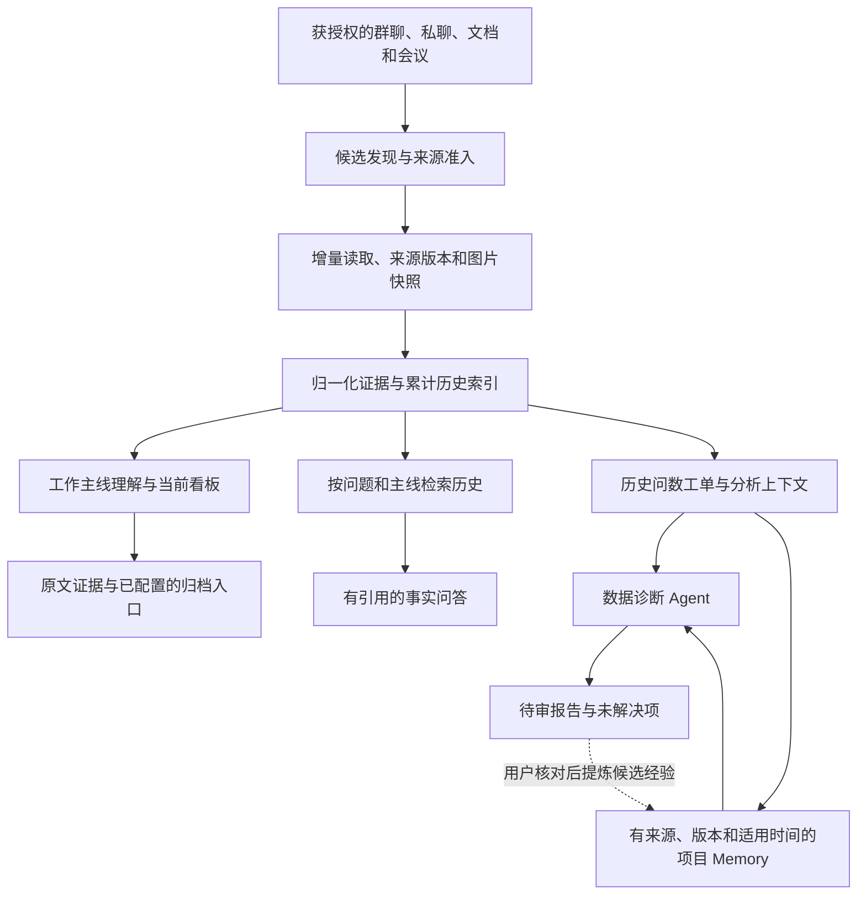

# 第三大脑 · Third Brain

把分散的办公对话、文档和会议资料，变成有依据的工作进展与可审阅的数据分析。

本仓库提供可独立安装的公开 Alpha。下文的架构与示意截图介绍个人原型的设计和验证，不表示所有模块都已进入公开版；公开版当前能力与安装步骤见[公开版 Alpha](#公开版-alpha)。

## 从什么问题出发

**事情推进到哪里了？这个指标为什么变了？** 答案经常跨越几次对话、一份交接文档、当天的看板图片和后来的回复。全量堆给模型会增加噪声和成本，只看近期卡片又会丢掉历史。

第三大脑因此从一个全知的个人分身，收敛为两个具体角色：

| 角色 | 交付 | 当前边界 |
| --- | --- | --- |
| 工作进展助理 PMO | 当前进展、跟进对象、卡点及待确认事项，逐项有依据 | 催办、对外发送和冲突裁决由用户确认 |
| 数据诊断助理 DA | 明确查询、核对变化、按需下钻、形成待审报告 | 简单问题走短流程；归因需要事实，不能仅凭相关性断言 |
| 找人和组织协作 | 谁负责、应找谁 | 依赖准确组织资料，暂不承诺完整覆盖 |

## 设计理念

- 相关性比活跃度重要：候选来源不是已关注来源，手动设置和禁止优先。
- 工作主线是持续演进的工作对象：可以跨群、跨文档，不固定塞进一组初始主线；新增、合并和归档要有依据。
- 累计历史与当前展示分开：看板只展示重点，历史按来源、版本、时间和稳定标识去重保留。
- 先理解问题，再决定做多少：一个数字不必写成长报告，复杂问题才进入有限循环。
- Memory复用口径和经验，不能替代事实：规范、指标定义和日期事实分开，保留时效与来源。
- 人负责承诺和裁决：保留冲突与未知，不按职位或模型置信度自动覆盖事实。

## 整体架构



累计索引和项目Memory使用私有本地文件。Embedding向量检索尚未接入；Mem0、OpenViking等只提供过设计参考，不表示已部署其服务。归档入口也不表示归档内容已自动同步到今天。

## Agent 的工作闭环


以请求分流、事实查证、回答准备和确认反馈四个阶段组织工作。图中展示整体业务设计；自动接收与回复、完整的事实确认闭环仍需继续验证。

数据诊断时，Agent在查证阶段完成标准Query改写、德普只读取数和结果核验；能回答原问题就形成待审报告，仍有可验证的假设则继续下钻，缺少口径或业务事实时请用户补充。最多三轮、三次查数，并受预算和权限限制。原话、引用原图、实际查询与结果分别保留。

## 判断模型的分工

个人原型中的三个判断节点使用火山方舟 System One API（beta），模型为 `doubao-seed-2-1-lite-260915`。

| 节点 | Decision负责 | 保留的边界 |
| --- | --- | --- |
| Query分流 | 对象、指标、周期、比较和目标是否明确；简单/复杂/需补充 | 原模型继续改写Query；程序检查来源、日期和查询方案兼容性 |
| 文档实质内容 | 已读正文有实质、为空白模板、还是覆盖不足 | 先检查授权与hash，不改变业务相关性准入，节选不足不判全文为空 |
| Memory适用性 | 判断有限候选是否适用并排序，选择注入 | 来源授权、版本、时效、冲突和数量大小限制不可放宽 |

群监听准入、主线关联与优先级、开放新主线发现、Loop完结判断、报告盲评、事实问答和生成模型未在这一轮切换。Decision失败不自动换模型。业务用户上传文档进入何种技能的分流不在本次范围。

## Memory 的复用路径


“收到”或“OK”不自动证明结论正确。历史数字不能当当前数字，后来答案不能泄漏到更早的回放。用户可查看项目Memory、依据和实际注入记录；从所有历史交付自动提炼可靠经验仍需继续验证。

## 产品界面

以下画面使用个人原型界面加载完全虚构的示例数据。项目、角色、看板曲线、查询结果和报告均为示意，不含真实业务记录，未调用模型或查数服务。

### 工作概览


### 业务问答与依据回查


### 主动发现

核对原图和问题，再分流到单次查数或循环分析；每一步都可查看对应规范。


选择看板后查看统计日、推送时间和原图，再补充要分析的问题。


阶段报告区分已回答和仍缺少的部分，保留下一步需要人工补充的事实。


## 如何评估

看任务结果，而不只看文风：核对问题和引用对象是否对齐、口径和日期是否正确、总体与分群是否答全、是否精确找人，以及人工补充、查询、调用、耗时和费用。Memory评测使用相同原问题、证据和截止时间的有/无Memory对照。

已做30条冻结样本、六类判断的双模型影子对照，共60次真实调用；包含控制变体且待人工评阅，一致率不是正确率。双方都曾高分漏判缺总体和统计单位的报告，单设高置信阈值不足以支持自动结束。该对照不是30次完整查数任务。

进一步阅读：[产品思路与需求拆解](docs/product/product-rationale.md)。

---

## 公开版 Alpha

这是可独立安装的 **Local-first Alpha 产品版**：每位安装者在自己的电脑运行服务，使用自己的 WPS 企业应用、用户 OAuth 和自选模型 API。维护者不会收到安装者的 Token、消息或分析结果。

项目同时维护“个人版”与“公开版”：新能力先在维护者的个人版验证，只有可公开的通用代码和产品承诺才会进入候选分支。发布流程是：**个人版验证 → 公开候选分支 → 隐私扫描与人工复核 → 用户确认 → 公开版**。维护者的私人文档、办公授权和本地数据不会同步进来。

当前可运行切片用于尽快验证一个问题：它能不能从你亲自选择的少量 WPS 群聊里，找出值得关注的工作信号，并用可读的中文说明为什么。这是公开版的当前 Alpha 能力边界，不是把公开版定义成只能演示的 Demo。

## 能做什么

- 在本机完成 WPS 用户 OAuth；
- 使用当前用户身份读取其有权访问的会话，不要求把机器人加入群聊；
- 选择 1–10 个群聊，导入最近 1–30 天的文本消息；
- 只有在用户显式点击“分析”后，才把所选消息发送给该用户配置的 OpenAI-compatible 模型 API；
- 将 WPS Token、消息和分析结果加密保存在当前电脑；
- 展示业务化候选，供用户判断“重要、相关但非重点、噪声、不确定”。
- 提供一个独立的本地合成候选工作台：固定 7 个中性样例，由独立冻结 manifest/digest 校验全部业务字段、候选顺序、最小依据与证据集合；仅合成冲突候选展示两项中性说法，安装者须从空白字段填写事件类型、业务事实和 ISO UTC 发生时间；这些记录只停留在候选层，不会自动改写工作事件、线程或当前状态。

当前版本不会发送 WPS 消息、不会自动扩展监控来源、不会上传到维护者服务器，也不是生产部署。

当前仓库使用 [GNU Affero General Public License v3.0](LICENSE)。开源许可只适用于本仓库代码，不授权或要求公开任何安装者的 WPS 数据、模型 Key 或本地记忆。

## 问题反馈边界

公开 Alpha 暂未提供 **Report to Issue**，包括本地草稿、预览、确认、历史、更正和撤销。该能力会在后续独立 Ticket 中重新定义和验收；当前版本不保留任何可达入口。

## 五分钟开始

需要：Node.js 20+、一个 WPS 企业自建应用，以及一套 OpenAI-compatible 模型 API 配置。

```bash
npm install
npm start
```

首次启动会在终端显示本地地址。用浏览器打开 `http://127.0.0.1:4310` 后进入设置导览；页面会逐步告诉你：

1. 去哪里创建 WPS 企业自建应用并取得 App ID / App Key；
2. 需要申请哪两项 WPS 权限；
3. 在哪里填写本地 OAuth 回调地址；
4. 如何填写模型服务商、API 地址、模型名称／Endpoint ID 和自己的 API Key；
5. 哪些值只保存在当前电脑，不能发给别人。

按导览保存后，停止并重新运行：

```bash
npm start
```

也可以继续使用 `npm run setup` 手动创建 `.env.local`，再运行 `npm run preflight` 检查。

打开 `http://127.0.0.1:4310`，完成配置后按页面顺序：

1. 授权当前 WPS 账号；
2. 读取会话清单；
3. 选择 1–3 个熟悉的群和最近 7 天；
4. 导入消息；
5. 明确点击分析，再判断结果是否有用。

## WPS 应用配置

在 WPS 开放平台创建企业自建应用：

- 用户授权回调：`http://127.0.0.1:4310/oauth/wps/callback`
- 用户基础信息：搜索 `kso.user_base.read`，选择权限类型 `user`
- 用户消息 MCP：搜索 `kso.mcp_message.readwrite`，选择权限类型 `user`

不要在开放平台搜索框输入 `delegated:`，也不要选择同名的 `app` 权限。权限必须先在开发者后台申请并随版本审批发布，然后每位安装者使用自己的账号重新 OAuth。不要复制浏览器 `WPS_SID`。

详见 [WPS 权限与授权](docs/WPS-PERMISSIONS.md)。

## 隐私边界

- `.env.local`、`.runtime/`、日志和本地数据均被 Git 忽略；
- 本地凭证、消息与分析结果使用 AES-256-GCM 加密后落盘，文件权限限制为当前用户；
- 本地加密主要防止误上传和明文泄漏，不能抵御已经控制该电脑账户的恶意程序；
- 点击“分析”意味着所选消息会发送至安装者配置的模型 API；不点击则不会调用模型；
- 每人必须使用自己的 WPS OAuth 和模型 Key。严禁共用维护者或其他同事的办公凭证。

详见 [隐私说明](docs/PRIVACY.md)。

## 发布检查

```bash
npm test
npm run check
npm run verify
```

检查覆盖：凭证字面量、私人绝对路径、私人飞书/WPS 文档链接、数据文件、环境文件、软链接和独立安装。维护者还可传入只存在私人环境的 denylist：

```bash
node scripts/check-release.mjs --denylist /absolute/private/denylist.txt
node scripts/check-public-git.mjs --denylist /absolute/private/denylist.txt
npm run release:gate -- --denylist /absolute/private/denylist.txt
```

第一条检查当前文件，第二条检查已删除文件仍可能残留的完整 Git 历史。真正发布前必须运行第三条发布总门；它强制使用同一份私人 denylist，并串行执行当前文件、完整 Git 历史和干净安装验证。缺少 denylist 时发布总门会直接失败。

## 已验证与未验证

已在无私人配置的干净目录验证：安装、单元测试、发布扫描、配置预检和静态 Demo。

由于发布环境没有安装者的 WPS 应用、OAuth 和模型 Key，以下必须由每位试用者首次运行时验证：WPS 权限审批、真实 OAuth、会话读取、消息分页、所选模型请求与结果质量。未验证能力不会写成已完成。

进一步阅读：[安装](docs/INSTALL.md) · [架构](docs/ARCHITECTURE.md) · [模型配置](docs/MODEL-CONFIG.md) · [首版限制](docs/PREVIEW-LIMITS.md) · [隐私说明](docs/PRIVACY.md)