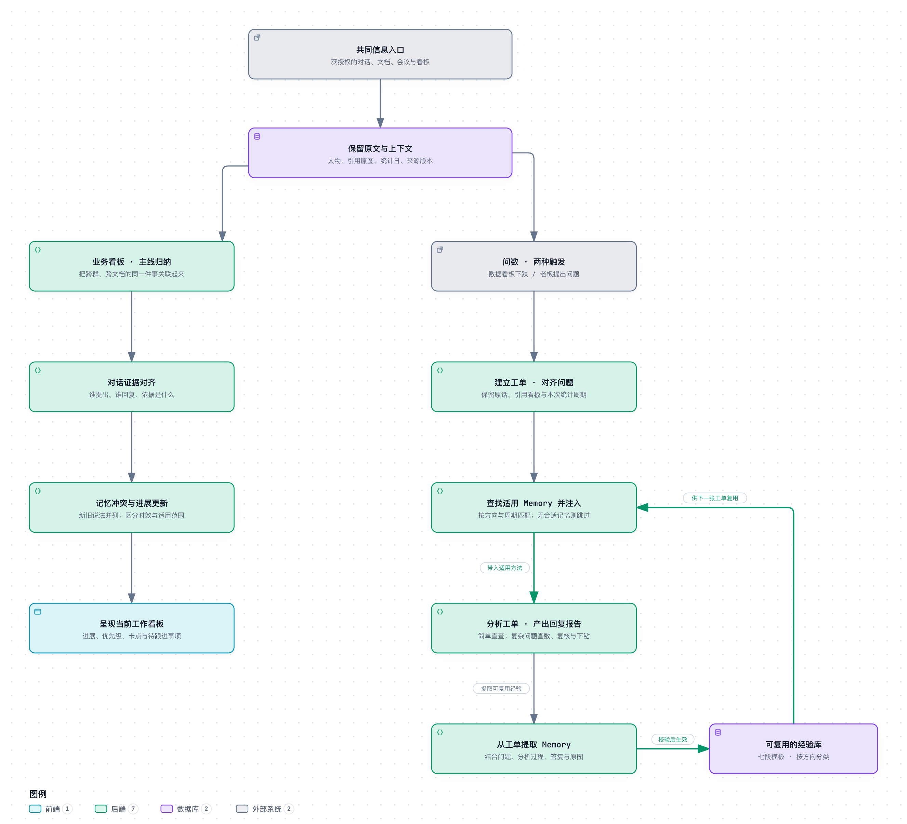
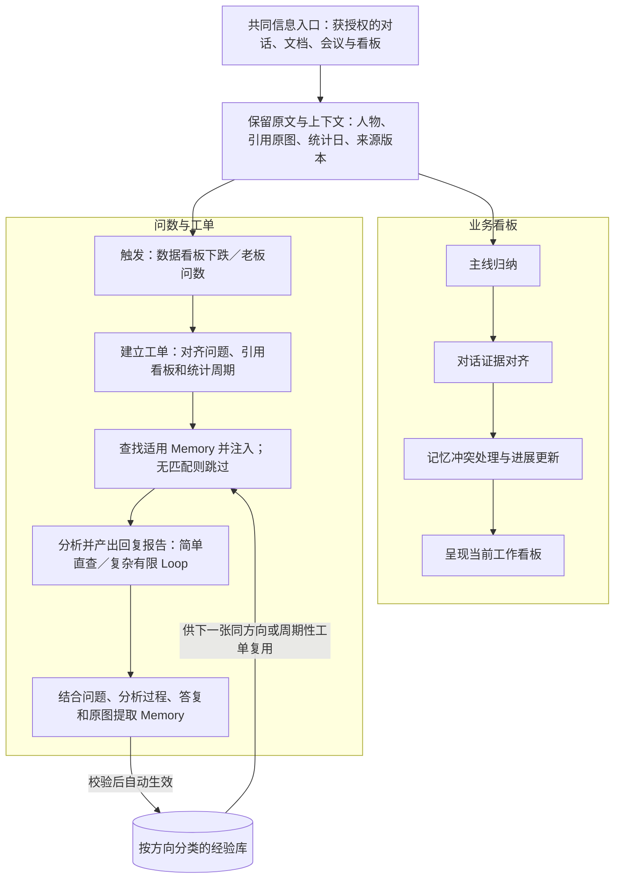

# 第三大脑项目架构：两条业务流

本图按业务的发生顺序组织，而不是按技术模块分层。顶部保留共同的信息入口和原文上下文，向下分成业务看板与问数；工单完成后留下方法，供下一张相关工单复用。

## 可编辑流程图

## 工单与 Memory 如何流转

1. 新工单保留用户原话、引用的看板原图和本次统计周期。
2. 查找同方向、周期性问题的经验，并检查来源、时效和适用条件；不适用时可以不注入。
3. 将适用方法带入 Query 改写与结果复核。简单查询走短路径，复杂问题在授权和预算内有限下钻；必要时请求补充资料。
4. 形成回复报告，保留查询依据、仍未解释的问题及需要的当前资料。
5. 由工单的提问、分析过程、答复及可读取的原图提取七段 Memory；通过检查后自动生效，无需逐条人工批准。
6. 下一张相关工单可以复用方法，仍需重新核对本期数据。工单应能区分“命中的记忆”与“实际注入的内容”。

七段模板：**原文、问题模式、下次如何回答、交付清单、适用条件、不能直接套用、仍需当前资料。**

## 两侧记忆的职责

业务看板维护当前业务事实与进展；工单 Memory 沉淀可复用的方法。冲突保留新旧说法、证据、版本和适用范围，无法确认时标为待核实，不自动替用户裁决。

## 设计与当前实现

这是目标业务流示意，不代表所有自动环节已经启用。当前提取由工单按钮或命令触发，通过来源、结构与引用检查后自动生效；看板下跌自动建单、业务冲突统一处理仍需接入验收。

当前由模型按固定模板提取，本地模块负责分类、保存、召回与注入。Mem0 尚未接入，历史事实不能替代本期数据。更多实现范围见[Memory说明](../product/memory.md)。

图中没有真实业务记录、人物身份或内部文档链接。
