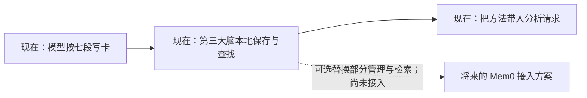

# 从工单留下下一次能用的经验

Memory 在这里是一张“下次遇到类似问题，可以怎样回答”的经验卡。它把过去讨论中的分析顺序和适用条件留下来，把当时的金额、结论和待核对事项分开。后续问题可以借用方法，再重新查本期数据。

**当前由 DeepSeek 按固定模板提取，第三大脑自己的本地模块负责保存、分类、查找和带入请求。Mem0 没有接入业务链路。** 可以把模型想成写卡片的整理员，把本地文件和查找程序想成分类夹与目录；当前这两部分已经能配合工作，不需要先安装 Mem0。

## 一张经验卡是什么样

下面用“某服务的 7 月、8 月账单核对”说明。对话、服务和步骤均为虚构示例，用来展示结构，不是历史工单的复述，也不代表已经执行过这次查询。

【原文】展开虚构的 7 月提问与答复

**提问者：** 7 月服务账单和内部用量汇总对不上，能看看差在哪里吗？

**分析者：** 我先统一结算月份、统计截止时间和计费单位，再按资源类别核对用量与单价。折扣、冲正和跨月调整单独列出，最后把每一项差异对应到凭据。尚未核实的项目先保留，不把差额直接当成漏记。

原文作为依据保留；页面默认折叠，优先展示下面的方法。

### 【问题模式】

同一服务每月需要把账单与内部用量汇总对齐，说明差异在哪里、哪些已解释、哪些仍需核实。

### 【下次如何回答】

1. 先对齐本期结算周期、截止时间、服务范围和计费单位，确认比较的是同一批数据。
2. 按相同资源类别拆开用量、单价与费用，逐项建立对应关系。
3. 将折扣、冲正和跨月调整分开核对，为差异标明依据，不从总额差异直接推断原因。
4. 汇总已解释与未解释的差异，给出仍需补充的材料和下一步。

### 【交付清单】

- 一份可回查凭据的账单与用量对照表。
- 一份区分“已解释”和“待核实”的差异清单。

### 【适用条件】

- 同一服务的周期性账单核对，且账单与用量能够对应。
- 需要先解释核算差异，再讨论成本变化。

### 【不能直接套用】

- 不沿用 7 月的金额、单价、差异原因或“已经对齐”的结论。
- 服务范围或计费规则变更时，先重新确认口径，不能直接照搬旧分类。

### 【仍需当前资料】

- 本期账单、用量明细与对应凭据。
- 本期生效的计费规则，以及已发生的折扣、冲正和跨月调整。

## 从 7 月用到 8 月，发生了什么

8 月再问“这期账单为什么对不上”，系统先找同方向的经验。找到上面的卡片后，带入的是“先对齐周期和单位，再拆用量、单价和调整项”的方法，不是 7 月的答案。

这是一种上下文工程：让分析助手在需要时拿到少量、相关、有来源的方法。面对“成本为什么变化”这样更开放的问题，记忆可以帮助它提出查证顺序和缺失材料；当前原因仍需要新证据支持。

实际带入模型的参考块包含问题模式、所需输入、步骤、输出、适用边界和标准 Query 的参考结构。改写时再填入当前对象、统计周期、比较周期和已经核实的口径。该参考块作为 System Prompt 中的业务资料，不授予新工具或新查询权限；原图由上游模型理解，不表示原图已经上传给德普。

## 现在是谁在做这些事

| 环节 | 当前公开实现 |
| --- | --- |
| 读工单 | 沿已保存的提问、答复及明确的引用／回复关系读取；可加入已下载且核验过的原图 |
| 抽取 | DeepSeek 按七段模板写经验卡，同时区分方法与当时事实 |
| 保存和分类 | 第三大脑本地文件保存经验及版本；按成本、指标汇报、异常口径等方向组织 |
| 召回 | 程序先检查来源、版本与时间，再按方向、关键词和文本重合线索排序，选取有限条目 |
| 注入 | 每次分析请求前重新核验，将仍适用的方法带入 Query 改写及结果复核，保存实际带入内容 |
| Mem0 | 未接入；当前包没有 Mem0 运行依赖，也没有业务读写或检索调用 |

**本公开包的召回没有独立调用 Decision 做二次重排，也没有向量检索。** 方向分类能帮助浏览和初步查找，但不能保证理解所有同义表达或抽象问题。是否需要更强的召回，要用后续问题的测试集检验。

将来如果采用 Mem0，可以考虑用它替换部分记忆管理与检索模块；七段结构、来源关联和本期数据核对仍需保留。这是可选设计，不是当前运行链路的一部分。

## 在页面上怎么核对

在历史工单的「记忆」页可以点击「提取／更新 Memory」。成功提取并通过来源、格式和引用检查后，方法自动生效，不再逐条等待人工确认；**这不等于每结束一次会话都会自动在后台提取**。没有可复用步骤时可以不生成记忆，失败或状态不明的输出不会变成可用方法。

项目记忆页按方向展示经验卡，可以展开原文和原图、回到原工单。工单的「记忆」页将“本单产出”“找到的相关记忆”“分析时实际使用的记忆”分开显示。匹配不等于注入；有保存的实际带入内容并收到模型响应，才显示已使用。收到响应也不等于方法有效，仍要看最终回答。

## 怎样验证它有没有帮助

可用较早工单的记忆回答较晚、同方向的周期问题。比较有／无 Memory 时保持模型、原问题和当前证据一致，留出较晚工单后来的答复，避免提前看到答案。

当前周期方法对照入口展示的是**指定带入上期记忆、没有执行查数工具的方法迁移试验**：它可以比较回答是否有更具体的分析顺序，不能证明自动召回准确，也不能证明账单已经核对完成或完整 Loop 成功率提高。完整 Loop 对照还需要同样的只读查数连接、本期数据与最终报告验收。

## 配置自己的数据

在 `THIRD_BRAIN_WORKBENCH_CONFIG` 指定的仓库外文件中配置以下路径；所有路径都指向安装者自己的绝对路径。

| 字段 | 用途 |
| --- | --- |
| historicalTicketsPath / historicalTicketScopePath | 工单与独立授权的历史范围；日期和原生会话标识必须对应 |
| attentionPath / questionContextsPath | 当前来源权限与消息引用关系 |
| memoryPlaybooksPath | schemaVersion 为 memory-playbooks-v1 的存储；初始 records、cases 为空，builds 为空对象 |
| memoryBuilderPath | DeepSeek 提取设置，见下文 |
| memoryReusePath | 允许哪些查数来源参考这些方法 |
| memoryPeriodicTestPath / memoryEvaluationPath | 可选的已完成试验记录；不配置则不显示对照入口 |

提取设置版本为 `deepseek-ticket-memory/v1`，模型为 `deepseek-flash`，endpoint 为 `https://api.deepseek.com/chat/completions`。需提供 `ticketsPath`、`scopePath`、`attentionPath`、`messagesPath`、`originalsPath`、`mediaPath`、`seedPath`、`budgetDirectory`、`workDirectory` 和 `outputPath`。提取设置中的工单、授权、会话、输出路径须与工作台扩展配置一致。`outputPath` 必须位于仓库外的 `workDirectory` 内；原图必须已下载到本机并有来源绑定及哈希。数据契约可参考工作台的 `ticket-memory-builder.test.mjs` 虚构样本。

使用范围文件支持 `playbook-reuse-v2`：`enabledAt` 为启用时间，`autoActivate` 为 true，`sourceIds` 为允许参考这些方法的诊断来源 ID，`records` 为可选逐条配置，`disabledIds` 为停用项。自动生效不扩展查数来源或查询权限。原有 v1 逐条配置仍兼容。

提取凭据读取安装者的 `DEEPSEEK_API_KEY`（环境变量或安装目录的 `.env.local`）。在页面中点击工单的「提取／更新 Memory」会触发提取请求，刷新页面不调用模型；也可由部署者显式运行提取脚本。提取与诊断可指向同一预算目录，共享每日上限；提取默认每日 10 元，图片理解阶段共享每日 2 元子上限。预算不足保留待处理。

每次最多输入两张有明确引用关系的原图；临近但未确认的图片不参与提取。页面显示本轮读取范围和缺口。图片本地路径不直接暴露为前端地址；更新记忆会保留旧版本。
